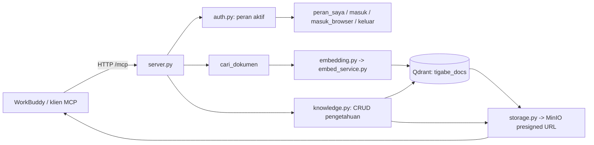

# TigaBeMCP

MCP (Streamable HTTP) untuk manajemen pengetahuan & pencarian dokumen resmi
SD TigaBe. Dokumen PDF disimpan di **MinIO**, dipecah (chunk) + di-embed ke
**Qdrant**, lalu dicari lewat chat (WorkBuddy) dengan filter akses berdasarkan
**peran**.

## Isi dokumen ini

1. [Arsitektur & alur](#arsitektur--alur)
2. [Prasyarat & setup](#prasyarat--setup)
3. [Menjalankan service](#menjalankan-service)
4. [Interface (web)](#interface-web)
5. [Menghubungkan WorkBuddy](#menghubungkan-workbuddy)
6. [Tool MCP](#tool-mcp)
7. [Peran & akses](#peran--akses)
8. [Daftar setiap berkas](#daftar-setiap-berkas)
9. [Pengembangan lanjut](#pengembangan-lanjut)

---

## Arsitektur & alur



1. **Pencarian** — pertanyaan → `embed_query` → vektor → cari di Qdrant dengan
   filter `tingkat_akses` sesuai peran → kembalikan kutipan + `document_url`
   (presigned PDF dari MinIO, berlaku `PRESIGN_EXPIRY_MINUTES` menit).
2. **Manajemen pengetahuan** — halaman `/pengetahuan` untuk unggah PDF → MinIO
   → chunk + embed → Qdrant; status tiap dokumen (sudah di MinIO? sudah di
   Qdrant?) bisa dilihat; bisa dihapus.
3. **Peran** — login via chat (`masuk_browser` → browser) atau cepat (`masuk`),
   `keluar` untuk kembali ke publik; akses dokumen difilter di sisi server.

## Prasyarat & setup

```bash
pip install -r requirements.txt
cp .env.example .env          # isi kredensial MinIO / Qdrant / embedding
```

Variabel penting di `.env`:

| Nama | Guna |
| --- | --- |
| `MINIO_PUBLIC_ENDPOINT/ACCESS_KEY/SECRET_KEY/BUCKET` | penyimpanan PDF (butuh izin `s3:PutObject`/`s3:DeleteObject` untuk unggah) |
| `QDRANT_URL/API_KEY/COLLECTION` | gudang vektor `tigabe_docs` |
| `EMBED_URL/EMBED_TOKEN` | layanan embedding (default `http://127.0.0.1:18110`) |
| `MCP_PUBLIC_URL` | URL publik server MCP (boleh `http://127.0.0.1:18105/mcp` untuk lokal) |

Buat pengguna login:

```bash
python scripts/buat_user.py --username sari --peran guru --password "rahasia"
python scripts/buat_user.py --username budi --peran siswa --password "rahasia"
```

## Menjalankan service

Dua proses wajib hidup bersamaan:

```bash
# terminal 1 — layanan embedding (model E5 dimuat sekali)
python scripts/jalankan_embed.py

# terminal 2 — server MCP + login + admin + pengetahuan
python scripts/jalankan_lokal.py
```

Cek kesehatan:

```bash
curl http://127.0.0.1:18110/health    # {"model":"intfloat/multilingual-e5-small","dim":384}
curl http://127.0.0.1:18105/login-browser?token=   # (halaman login; tanpa token -> 404 wajar)
```

> `scripts/jalankan_lokal.py` otomatis menyetel `MCP_PUBLIC_URL` ke origin lokal,
> sehingga popup login browser WorkBuddy menunjuk URL yang benar.

## Interface (web)

Hanya bisa dibuka dari `localhost`.

| URL | Isi |
| --- | --- |
| `/admin` | CRUD pengguna login & definisi peran |
| `/admin/audit` | riwayat chat/panggilan tool (dashboard) |
| `/pengetahuan` | **manajemen pengetahuan**: unggah PDF → MinIO → Qdrant, cek status, hapus |
| `/login-browser` | form login browser (dibuka dari `masuk_browser`) |

Aktivitas chat tersimpan di `audit_log.json` (array JSON; password otomatis
disensor `********`).

## Menghubungkan WorkBuddy

1. Jalankan dua service di atas.
2. Tutup penuh WorkBuddy (tray → Quit), buka lagi.
3. **Settings → MCP → Add MCP Server**:
   - Type: **HTTP**
   - URL: `http://127.0.0.1:18105/mcp` (atau `https://<host>/mcp` di produksi)
   - Tanpa header autentikasi (server tidak memaksa 401 saat connect).
4. Pilih **expert `TigaBe AI`** di daftar expert, lalu tanya soal sekolah.

Ekspor skill/plugin WorkBuddy ada di `workbuddy-export/` (SKILL.md, plugin.json,
`.mcp.json`, dan paket expert `tigabe-ai`). Dokumentasi rinci: `EXPORT-WORKBUDDY.md`.

## Tool MCP

| Tool | Fungsi |
| --- | --- |
| `peran_saya` | peran aktif + akses dokumen |
| `masuk(username, password)` | login cepat dari chat (password terlihat model — hanya cadangan) |
| `masuk_browser` | buat tautan login browser sekali-pakai (jalur aman) |
| `cek_login` | konfirmasi selesai login browser |
| `keluar` | kembali ke peran publik |
| `cari_dokumen(query, top_k, tanggal_acuan)` | cari dokumen sesuai peran |

## Peran & akses

Didefinisikan di `auth.py` → `PERAN_BAWAAN`, dapat ditimpa lewat `roles.json`.

| Peran | Akses `tingkat_akses` |
| --- | --- |
| `publik`, `orang_tua` | `public` |
| `siswa`, `guru` | `public`, `class` |
| `kepala_sekolah` | semua dokumen aktif (`semua_akses`) |

## Daftar setiap berkas

### Inti server & autentikasi

| Berkas | Fungsi |
| --- | --- |
| `server.py` | Pintu utama MCP: mendefinisikan 6 tool, memasang rute login/admin/pengetahuan, menjalankan uvicorn (`jalankan()`) |
| `oauth_provider.py` | Authorization server internal (code + PKCE), halaman `/login`, `/ganti`, `/login-browser`, penyimpan token + sesi chat, login browser sekali-pakai |
| `auth.py` | Definisi peran (`PERAN_BAWAAN`), pemetaan `akses` → `tingkat_akses`, daftar host/origin yang diizinkan |
| `admin_page.py` | Halaman admin web: CRUD pengguna login & peran kustom, tab audit |
| `audit.py` | Catat setiap panggilan tool (user, peran, tool, argumen tersensor) ke `audit_log.json` |

### Pengetahuan & pencarian

| Berkas | Fungsi |
| --- | --- |
| `knowledge.py` | CRUD pengetahuan: `daftar_pengetahuan`, `unggah_pdf`, `status_pengetahuan`, `hapus_pengetahuan` |
| `pengetahuan_ui.py` | Halaman `/pengetahuan`: upload PDF, tabel status MinIO/Qdrant, hapus |
| `search.py` | Query embedding + filter Qdrant + presigned URL; status `ok`/`error_embed`/`error_qdrant` |
| `ingest.py` | Parse PDF → header meta → chunk per pasal → embed → upsert ke Qdrant; fungsi reusable `proses_pdf` & `dorong_ke_qdrant` |

### Penyimpanan & embedding

| Berkas | Fungsi |
| --- | --- |
| `storage.py` | Klien MinIO: `unggah_objek`, `ada_objek`, `hapus_objek`, presigned URL, ambil objek |
| `embedding.py` | Klien HTTP ke layanan embedding (`embed_passages` / `embed_query`) |
| `embed_service.py` | Layanan FastAPI embedding (`/embed/passages`, `/embed/query`, `/health`) dengan token opsional |
| `embedding_lokal.py` | Muat model E5 (`intfloat/multilingual-e5-small`, 384 dim) sekali + encode |

### Skrip bantu (`scripts/`)

| Berkas | Fungsi |
| --- | --- |
| `jalankan_lokal.py` | Launcher server MCP lokal (set `MCP_PUBLIC_URL`/host/port otomatis) |
| `jalankan_embed.py` | Launcher layanan embedding |
| `buat_user.py` | Tambah/ubah pengguna login (hash scrypt ke `login_users.json`) |
| `tes_cari.py` | Uji pencarian (`search.cari`) langsung |
| `tes_embedding.py` | Uji layanan embedding |
| `tes_presign.py` | Uji pembuatan presigned URL MinIO |

### Lainnya

| Berkas | Fungsi |
| --- | --- |
| `test_client.py` | Uji end-to-end klien MCP (login + `peran_saya` + `cari_dokumen`) |
| `login_users.json` | Pengguna login (hash) — tidak di-commit |
| `roles.json` | Override peran kustom — tidak di-commit |
| `audit_log.json` | Riwayat audit — tidak di-commit |
| `workbuddy-export/` | Skill + plugin MCP untuk WorkBuddy |
| `EXPORT-WORKBUDDY.md` | Panduan pemasangan ekspor WorkBuddy |

## Pengembangan lanjut

- **Menambah peran** → `auth.py` `PERAN_BAWAAN`, atau kunci `roles` di `roles.json`, restart server.
- **Menambah tool** → dekorasi `@mcp.tool()` di `server.py`; peran dibaca via `_peran_efektif()`.
- **Menambah halaman** → ikuti pola `admin_page.py`/`pengetahuan_ui.py`: fungsi `pasang_*(mcp)` dengan `mcp.custom_route(...)` + guard localhost.
- **Menambah sumber dokumen** → cukup unggah lewat `/pengetahuan` (tidak perlu edit kode).
- **Audit** → `audit.catat_aktivitas(...)` di hook; lihat `/admin/audit` atau `audit_log.json`.
- **Autentikasi produksi** → gunakan `masuk_browser` (password tidak lewat chat); ganti penyimpanan in-memory ke DB bila multi-proses.

Kontrak antar modul ringkas: `server.py` menyatukan semua route/tool, `oauth_provider.py`
memegang identitas/sesi, `auth.py` memegang aturan peran, `knowledge.py` mengabstraksi
MinIO+Qdrant untuk dokumen, dan `search.py` hanya mencari (baca).