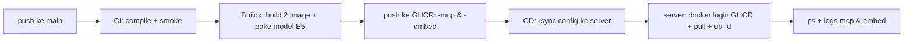

# Deploy & CI/CD TigaBeMCP

Dua layanan berjalan di server: MCP (`server.py`) dan embedding
(`embed_service.py`). Sejak model E5 wajib ada, **image dibangun di GitHub
Actions lalu dipush ke GHCR**; server hanya `pull & up` — TIDAK butuh akses
huggingface.co / pypi di server.

## 1. Sekali di server (setup tujuan deploy)

```bash
# folder repo tujuan (harus sudah berisi repo ini)
cd /workspaceaitf/TigaBeMCP/TigaBe-ok

# env rahasia HARUS sudah ada di server (tidak pernah di-commit/deploy)
test -f .env || echo "SALIN .env ke server!"
mkdir -p runtime-data
```

## 2. Secrets GitHub (Settings → Secrets and variables → Actions)

CI/CD membangun image di GitHub (internet tersedia -> model E5 ter-bake),
push ke `ghcr.io`, lalu server `docker compose -f docker-compose.prod.yml pull && up`.

Folder tujuan server standar: **`/workspaceaitf/TigaBeMCP/TigaBe-ok`**.

| Nama | Isi | Wajib? |
| --- | --- | --- |
| `DEPLOY_HOST` | IP publik/FQDN server yang bisa dijangkau GitHub (bukan `srv1603727` internal) | Ya |
| `DEPLOY_PORT` | port SSH, mis. `22` | Tidak (default 22) |
| `DEPLOY_USER` | user SSH, mis. `root` | Ya |
| `DEPLOY_PATH` | `/workspaceaitf/TigaBeMCP/TigaBe-ok` | Ya |
| `DEPLOY_SSH_KEY` | private key pasangan `~/.ssh/id_ed25519.pub` di server | Ya |
| `DEPLOY_GHCR_USER` | username GHCR untuk `docker login` di server (mis. nama akun GitHub) | Ya (image private) |
| `DEPLOY_GHCR_TOKEN` | PAT scope `read:packages` untuk `docker login ghcr.io` | Ya (image private) |

Penting:
- `DEPLOY_SSH_KEY` & `DEPLOY_GHCR_TOKEN` = credential, simpan sebagai **GitHub secret**, tidak pernah di file repo.
- `DEPLOY_HOST` harus IP/FQDN yang **bisa di-resolve dari internet**. Nama host
  internal seperti `srv1603727` TIDAK bisa di-resolve runner GitHub.

### Cara dapat `DEPLOY_GHCR_TOKEN`

1. GitHub → Settings → Developer settings → Personal access tokens (classic).
2. Scope: **`read:packages`**.
3. Simpan token ke secret `DEPLOY_GHCR_TOKEN`, dan username akun ke `DEPLOY_GHCR_USER`.

Bila image GHCR dibuat **publik** (Settings → Packages → bagikan), login tidak
wajib dan kedua secret GHCR boleh dikosongkan.

## 3. Alur CI/CD



- **CI** (tiap push & PR): syntax-check semua `.py`, smoke import.
- **build-push**: build `Dockerfile.mcp` & `Dockerfile.embed` (model E5 di-prefetch
  SAAT build) → push ke `ghcr.io/<owner>/tigabe-mcp-{mcp,embed}:main` + tag `sha-<sha>`.
- **CD** (hanya push `main`, env `production`): rsync `docker-compose.prod.yml` +
  `deploy/` → server `docker login ghcr.io` → `docker compose pull && up -d`
  → cetak `ps` + log ringkas.

## 4. Deploy manual di server (tanpa menunggu CD)

```bash
cd /workspaceaitf/TigaBeMCP/TigaBe-ok
# sekali: login GHCR bila image private
echo "$GHCR_TOKEN" | docker login ghcr.io -u "$GHCR_USER" --password-stdin

docker compose -f docker-compose.prod.yml pull
docker compose -f docker-compose.prod.yml up -d
docker compose -f docker-compose.prod.yml logs --tail=30 embed
```

Harus terlihat baris seeding model (deploy pertama):
```
[entrypoint] seeding /models dari /models_baked ...
Application startup complete.
```

## 5. Verifikasi

```bash
curl -s http://127.0.0.1:18110/health          # {"model":"intfloat/multilingual-e5-small","dim":384}
curl -s -X POST http://127.0.0.1:18110/embed/query \
  -H "Content-Type: application/json" \
  -H "Authorization: Bearer $EMBED_TOKEN" \
  -d '{"texts":["seragam"]}'                   # 200 + vector (BUKAN 500)
```

## 6. Keamanan deploy

File sensitif **tidak pernah di-deploy** via CD; dibuat manual sekali di server:
`.env`, `roles.json`, `login_users.json`, `audit_log.json`, `runtime-data/`.

CD rsync mengecualikan semuanya (`--exclude`).

## 7. Berkas layanan opsional (systemd, non-Docker)

`deploy/tigabe-mcp.service` & `deploy/tigabe-embed.service` disediakan untuk
deploy **tanpa Docker** (jalan `python server.py` / `embed_service.py` langsung).
Path default `WorkingDirectory` sudah `/workspaceaitf/TigaBeMCP/TigaBe-ok`.
Alur utama kini pakai Docker (GHCR), bukan systemd.